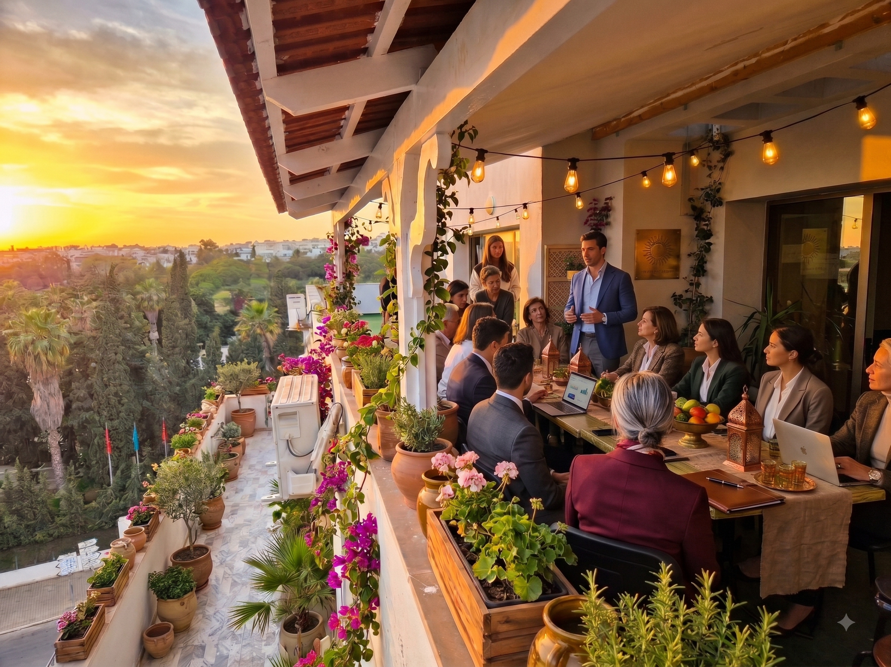

# Audit SEO — hivefivecoworking.com
**Date :** 11 août 2026 · **Site analysé :** HIVE FIVE, Business Center & Coworking, Belvédère Tunis

---

## Verdict en une phrase

Le site est **très bien construit** (structure, contenu, balises, version FR/EN, données structurées : tout est là et bien fait), mais **trois erreurs de déploiement** l'empêchent aujourd'hui d'être correctement indexé par Google. La bonne nouvelle : elles se corrigent toutes en moins d'une heure.

| Gravité | Problème | Temps de correction |
|---|---|---|
| 🔴 **CRITIQUE** | Balises canonical pointant vers un domaine **inexistant** | 10 min |
| 🔴 **CRITIQUE** | Images de 9 Mo → site très lent sur mobile | 20 min |
| 🟠 Important | Sitemap avec URLs cassées + robots.txt cassé | 5 min |
| 🟠 Important | 4 versions du site accessibles (contenu dupliqué) | 5 min |
| 🟡 Moyen | Google Business Profile : le levier n°1 non exploité | continu |

---

# 🔴 PROBLÈME 1 — Le plus grave : canonical vers un domaine qui n'existe pas

## Ce que j'ai trouvé

Toutes les pages du site contiennent ceci dans leur `<head>` :

```html
<link rel="canonical" href="https://www.hivefive.tn/">
<link rel="alternate" hreflang="fr" href="https://www.hivefive.tn/fr/index.html">
<meta property="og:url" content="https://www.hivefive.tn/">
```

**Or le domaine `hivefive.tn` n'existe pas.** Je l'ai testé : la résolution DNS échoue complètement (`Could not resolve host`).

## Pourquoi c'est catastrophique

La balise `canonical` dit à Google : *« la vraie adresse de cette page, celle que tu dois indexer, c'est celle-ci »*. Google la respecte quasi religieusement.

Résultat actuel : Google explore `hivefivecoworking.com`, lit « en fait la vraie page est sur hivefive.tn », essaie d'y aller… et tombe sur du vide. **Il n'indexe donc ni l'un ni l'autre.** C'est très probablement la raison pour laquelle le site ne ressort pas dans les résultats.

C'est l'erreur SEO la plus destructrice qui existe, et elle est présente sur **toutes** les pages : accueil, services, about, contact, international-companies, et toutes les pages FR.

## La correction

Deux options — choisis selon ta stratégie de marque :

**Option A — tu gardes hivefivecoworking.com (le plus simple, à faire maintenant)**

Dans **chaque fichier .html**, remplace toutes les occurrences de `hivefive.tn` par `hivefivecoworking.com`. En ligne de commande, à la racine du site :

```bash
find . -name "*.html" -exec sed -i 's|www\.hivefive\.tn|www.hivefivecoworking.com|g' {} +
```

Sur Windows / dans un éditeur : Rechercher-Remplacer dans tous les fichiers, `www.hivefive.tn` → `www.hivefivecoworking.com`.

**Option B — tu veux vraiment le domaine .tn**

Achète `hivefive.tn` (auprès de l'ATI ou d'un registrar tunisien), fais-le pointer vers le même hébergement, puis mets une redirection 301 de `hivefivecoworking.com` vers `hivefive.tn`. Un `.tn` est un léger plus pour le référencement local en Tunisie, mais **ne fais surtout pas ça à moitié** : tant que le domaine n'est pas acheté et actif, applique l'option A.

> ⚠️ **Bug secondaire trouvé :** dans `fr/index.html`, la ligne canonical se termine par un `>` en trop :
> `<link rel="canonical" href="..."">>` — à corriger aussi.

---

# 🔴 PROBLÈME 2 — Des images de 9 mégaoctets

## Ce que j'ai mesuré

| Image | Poids réel |
|---|---|
| `terrasse.jpg` | **8,99 Mo** |
| `reunion.jpg` | **8,20 Mo** |
| `bande.jpg` | 1,69 Mo |
| `open-space.jpg` | 190 Ko |

**Trois images = 18,9 Mo.** Une page web correcte pèse moins de 2 Mo au total.

## Pourquoi c'est grave

Sur une connexion mobile 4G tunisienne, ta page met **30 secondes à 1 minute** à s'afficher complètement. Or :

- Plus de la moitié de tes visiteurs arrivent depuis un mobile.
- Google mesure la vitesse (Core Web Vitals) et c'est un **facteur de classement officiel**.
- Un visiteur qui attend plus de 3 secondes part avant même de voir ton offre. Tu perds des prospects réels, pas juste des positions.

C'est probablement le second frein le plus important après le canonical.

## La correction

Objectif : **chaque image sous 200 Ko**, aucune plus large que 1920 px.

**Le plus simple, sans rien installer :** va sur [squoosh.app](https://squoosh.app) ou [tinypng.com](https://tinypng.com), glisse tes images, règle la largeur max à 1920 px et la qualité à 80, télécharge, remplace.

**Ou automatiquement :** j'ai écrit le script `optimiser-images.sh` (dans ce dossier). Copie ton dossier `images/` à côté et lance :

```bash
bash optimiser-images.sh
```

Il redimensionne, compresse et génère en plus des versions **WebP** (30 à 50 % plus légères).

**Deux détails techniques à ajouter dans le HTML** pendant que tu y es :

1. Ajoute `width` et `height` sur chaque `` — aucune de tes 26 images ne les a. Ça évite que la page « saute » pendant le chargement (métrique CLS, pénalisée par Google).
   ```html
   
   ```
2. L'image du hero (`open-space.jpg`) ne doit **pas** avoir `loading="lazy"` — c'est la première visible, elle doit charger en priorité. Mets-lui plutôt `fetchpriority="high"`.

---

# 🟠 PROBLÈME 3 — robots.txt et sitemap.xml cassés

## robots.txt

C'est le fichier que tu m'as envoyé :

```
Sitemap: https://www.https://www.hivefivecoworking.com//sitemap.xml
```

Le préfixe `https://www.` est dupliqué → URL invalide, Google ne trouve pas le sitemap.

## sitemap.xml

Le même bug de concaténation, plus grave encore. Voici ce qu'il contient réellement :

```
https://www.hivefivecoworking.com//services.html      ← double slash
https://www.hivefivecoworking.com/.html               ← URL fantôme (renvoie 403)
https://www.hivefivecoworking.com//fr/                ← double slash
```

**10 des 12 URLs ont un double slash**, et l'une est complètement vide (`/.html`, qui renvoie une erreur 403). Un sitemap rempli d'erreurs perd sa crédibilité auprès de Google. Il manque aussi `contact.html` en version anglaise.

Le fichier contient également ce commentaire, resté du développement :
```xml
<!-- ⚠️ Remplacez https://www.hivefivecoworking.com par votre domaine réel au déploiement -->
```
→ La cause racine de tout : les fichiers ont été générés avec des variables de template jamais remplacées proprement.

## La correction

Deux fichiers propres sont prêts dans `fichiers-corriges/` :
- **`robots.txt`** — URL du sitemap corrigée
- **`sitemap.xml`** — 12 URLs valides, doubles slashes supprimés, URL fantôme retirée, `contact.html` ajouté, et **balises hreflang** ajoutées pour lier proprement les versions FR et EN (Google comprendra que ce ne sont pas des doublons mais des traductions)

Uploade-les à la racine du site, en écrasant les anciens.

---

# 🟠 PROBLÈME 4 — Quatre versions du site en ligne simultanément

## Ce que j'ai testé

```
http://hivefivecoworking.com/       → 200 OK
http://www.hivefivecoworking.com/   → 200 OK
https://hivefivecoworking.com/      → 200 OK
https://www.hivefivecoworking.com/  → 200 OK
```

Les quatre répondent, **aucune ne redirige vers les autres**. Pour Google, ce sont quatre sites différents avec un contenu 100 % identique : c'est du **contenu dupliqué**, et ça dilue ton autorité sur quatre adresses au lieu de la concentrer sur une.

## La correction

J'ai préparé un fichier **`.htaccess`** (ton serveur est bien un Apache, je l'ai vérifié dans les en-têtes). Place-le à la racine du site. Il :

- redirige tout en **301** vers `https://www.hivefivecoworking.com` (force HTTPS + www) ;
- active la **mise en cache navigateur** (un an sur les images) ;
- renforce la compression gzip ;
- ajoute le type MIME WebP ;
- masque le listing des dossiers (sécurité).

> Si ton hébergeur n'est pas Apache mais Nginx, dis-le-moi et je te fournis la config équivalente.

---

# 🟡 LEVIER 5 — Google Business Profile : ton plus gros gisement

C'est **le** point le plus rentable pour un coworking, et il ne se joue pas sur le site.

Pour les recherches locales, Google pondère trois choses : la **proximité** du chercheur, la **pertinence** de ta fiche, et la **prominence** (notoriété). D'après l'enquête Whitespark 2026, la proximité pèse environ 55 % — tu ne la contrôles pas — mais les signaux de ta fiche Google pèsent ~32 % et les avis 16–20 %, et ceux-là sont **entièrement sous ton contrôle**. [2](https://www.replyonthefly.com/blog/local-seo-ranking-factors)

Ton schema affiche 4,9/5 avec 12 avis. C'est un bon départ, mais 12 avis, c'est peu pour dominer « coworking Tunis ».

### À faire, par ordre d'impact

**1. Catégorie principale exacte**
Mets **« Espace de coworking »** en catégorie principale (pas « Bureau » ni « Centre d'affaires »). C'est le signal de pertinence le plus fort de toute la fiche. Ajoute en secondaires : *Centre d'affaires*, *Location de salles de réunion*, *Centre de formation*, *Location de bureaux*.

**2. Les avis — le levier le plus puissant**
- Vise **au moins 30 à 50 avis**. Une étude montre un saut de classement notable au passage de 9 à 10 avis. [1](https://localdominator.co/local-search-ranking-factors/)
- Ce qui compte le plus n'est pas le total mais la **vélocité** : un flux régulier (2 à 4 nouveaux avis par mois) vaut mieux que 30 d'un coup, qui déclenche un filtre anti-spam.
- **Réponds à TOUS les avis, dans les 24 h.** Google a confirmé que ça améliore le classement, et les entreprises avec 80 %+ de taux de réponse voient un gain mesurable. [2](https://www.replyonthefly.com/blog/local-seo-ranking-factors)
- Méthode concrète : un QR code à la réception + un message WhatsApp automatique 48 h après l'arrivée d'un nouveau membre.
- Encourage les avis qui **mentionnent naturellement** ce que tu veux ranker : « salle de réunion à Belvédère », « bureau privé à Tunis ». Les mots-clés dans les avis sont un signal réel.

**3. Photos et posts**
- Minimum 20 photos, et ajoutes-en régulièrement (open space, terrasse, salles, façade, équipe).
- **Poste chaque semaine.** Les fiches actives obtiennent nettement plus de vues que les fiches dormantes. [4](https://blogy.in/resources/local-seo-guides/coworking-spaces-brand-names)
- ⚠️ Ne perds pas de temps à géotagger tes photos : Google supprime les métadonnées EXIF à l'upload, c'est un mythe. [2](https://www.replyonthefly.com/blog/local-seo-ranking-factors)

**4. Cohérence NAP (Nom, Adresse, Téléphone)**
Ton nom, ton adresse et ton téléphone doivent être **écrits exactement pareil** partout : site, Google, Facebook, Instagram, annuaires. La moindre variation (« Rue de Khartoum » vs « Rue Khartoum », `+216 57 010 915` vs `57010915`) affaiblit le signal.

**5. Complète tout**
Horaires (y compris jours fériés tunisiens), attributs (accès PMR, Wi-Fi, parking, climatisation), services avec prix, description, zone desservie. Une fiche complète obtient bien plus de clics qu'une fiche partielle. [4](https://blogy.in/resources/local-seo-guides/coworking-spaces-brand-names)

---

# 🟡 LEVIER 6 — Des pages dédiées par intention de recherche

Aujourd'hui, tout ton contenu commercial vit sur l'accueil et sur `services.html`. Or les gens ne cherchent pas « coworking » : ils cherchent **une chose précise, dans un endroit précis**.

Chaque intention mérite **sa propre page**, avec sa propre balise title, son H1 et son contenu. C'est comme ça qu'on capte des requêtes très qualifiées avec peu de concurrence.

### Pages à créer (par ordre de rentabilité)

| Page | Requête ciblée | Pourquoi |
|---|---|---|
| `location-salle-reunion-tunis.html` | *location salle de réunion Tunis* | Intention d'achat immédiate, très recherchée |
| `bureau-prive-tunis.html` | *bureau privé à louer Tunis* | Ton produit le plus rentable |
| `domiciliation-entreprise-tunis.html` | *domiciliation entreprise Tunis* | Fort volume, concurrence faible |
| `salle-formation-tunis.html` | *location salle de formation Tunis* | Marché B2B des organismes de formation |
| `coworking-belvedere.html` | *coworking Belvédère / Lafayette* | Requête hyper-locale, facile à gagner |

**Règle absolue :** chaque page doit avoir du **contenu unique et substantiel**. Des pages qui ne diffèrent que par le nom du quartier échangé dans un template sont une cause documentée de pénalisation. [3](https://mettevo.com/blog/article/local-seo-in-2026-how-to-rank-in-google-maps-and-the-local-pack) Écris de vrais textes : photos de la salle, capacité, équipement, tarifs, plan d'accès, FAQ propre à chaque service.

### Structure de title recommandée

```html
<title>Location Salle de Réunion Tunis — Belvédère | HIVE FIVE</title>
<title>Bureau Privé à Louer à Tunis — Meublé, Accès 24/7 | HIVE FIVE</title>
<title>Domiciliation d'Entreprise à Tunis — Adresse Commerciale | HIVE FIVE</title>
```

Formule : `mot-clé principal + ville/quartier + bénéfice | marque`, en restant sous 60 caractères.

---

# 🟡 LEVIER 7 — Données structurées enrichies

Ton schema `LocalBusiness` actuel est **correct mais minimal**. En l'enrichissant, tu débloques des affichages plus riches dans Google (étoiles, prix, horaires, questions dépliables) qui augmentent fortement le taux de clic.

J'ai préparé une version enrichie dans **`fichiers-corriges/schema-a-remplacer.html`**, qui ajoute :

- `openingHoursSpecification` au format structuré propre (au lieu du format texte simplifié) ;
- `hasOfferCatalog` : tes 4 offres avec leurs prix → Google peut afficher « à partir de 25 DT » ;
- `amenityFeature` : fibre, 24/7, terrasse, parking, réception… ;
- `areaServed` : Tunis, Belvédère, Lafayette, Lac 1, Lac 2, Centre Urbain Nord ;
- `sameAs` vers Instagram, `hasMap`, code postal, logo, images ;
- un bloc **`FAQPage`** — tu as déjà 16 questions dans ta section FAQ, mais **elles ne sont pas balisées**. Une fois balisées, elles peuvent s'afficher en accordéon directement dans les résultats Google. C'est un gain de visibilité gratuit et immédiat.

> ⚠️ Le texte du schema FAQ doit correspondre **mot pour mot** au texte visible sur la page, sinon Google ignore le bloc. Adapte mes exemples à tes vraies questions.

Vérifie ensuite sur [validator.schema.org](https://validator.schema.org) et dans le [test des résultats enrichis](https://search.google.com/test/rich-results) de Google.

---

# 🟡 LEVIER 8 — Détails techniques restants

**Ce qui est déjà bien fait, à conserver :**
- ✅ Un seul H1 par page, hiérarchie H2/H3 propre (12 H2, 22 H3)
- ✅ **26 images, toutes avec un attribut `alt`** — c'est rare, bravo
- ✅ `loading="lazy"` sur 22 images
- ✅ Meta description présente et bien rédigée
- ✅ Open Graph + Twitter Cards complets
- ✅ Version FR/EN avec hreflang
- ✅ gzip actif sur le serveur
- ✅ CSS et JS en inline (28 Ko + 12 Ko) → pas de requête bloquante

**À corriger :**

| Point | Détail |
|---|---|
| **3 images avec `alt=""` vide** | Si l'image est décorative, c'est correct. Si elle montre l'espace, décris-la : `alt="Terrasse rooftop de 300 m² surplombant Belvédère, Tunis"`. Ce sont aussi des positions gagnées en recherche d'images. |
| **`og:image` en chemin relatif** | `content="images/logo-square.png"` → doit être une URL absolue : `https://www.hivefivecoworking.com/images/logo-square.png`. Sinon l'aperçu ne s'affiche pas quand on partage le lien sur WhatsApp, LinkedIn ou Facebook. Idem pour `twitter:image`. |
| **`og:image` = le logo** | Un logo carré fait un mauvais aperçu. Utilise une belle photo horizontale (1200×630 px) de l'open space ou de la terrasse. Impact direct sur les clics depuis les réseaux sociaux. |
| **Pas de `x-default`** | Ajoute `<link rel="alternate" hreflang="x-default" href="https://www.hivefivecoworking.com/">` pour les visiteurs dont la langue ne correspond ni au FR ni à l'EN. |
| **Pas de cache navigateur** | Aucun en-tête `Cache-Control` détecté → le `.htaccess` fourni le règle. |
| **Pas de page 404** | Crée un `404.html` avec ton design et des liens vers les pages principales. |
| **URLs en `.html`** | Cosmétique, mais `/services` est plus propre que `/services.html`. À ne faire **que** si tu mets des redirections 301 propres — sinon ne touche à rien, le gain est marginal. |

---

# 🟡 LEVIER 9 — Hors du site : autorité locale

Le SEO ne se joue pas qu'sur ton serveur. Ces actions construisent ta **prominence** aux yeux de Google :

**Annuaires et citations** — inscris HIVE FIVE (avec un NAP strictement identique) sur : Bing Places, Apple Business Connect (de plus en plus important), Facebook, LinkedIn Company Page, Waze, Foursquare, TunisieAnnonce, Jumia Deals, les annuaires de la Chambre de Commerce de Tunis. La cohérence NAP à travers les annuaires est un signal de classement solide. [4](https://blogy.in/resources/local-seo-guides/coworking-spaces-brand-names)

**Backlinks locaux** — les liens venant de sites tunisiens pèsent lourd pour une requête locale :
- Chambre de Commerce et d'Industrie de Tunis
- Écosystème startup : Smart Capital, Startup Tunisia, Flat6Labs, Wiki Start Up
- Presse tech locale (THD, Managers, Web Manager Center) — un communiqué sur ton espace, tes hackathons
- Universités et écoles proches (tu es à Belvédère : IHEC, ESSEC Tunis, ISG)
- Partenariats : héberge des meetups, des hackathons, des Startup Weekends → chaque événement génère des mentions et des liens

**Contenu blog** — tu as déjà `blog.html`. Alimente-le avec des sujets à intention locale réelle :
- « Combien coûte un bureau à Tunis en 2026 ? Comparatif location classique vs coworking »
- « Créer une société en Tunisie : les démarches et l'adresse de domiciliation »
- « Les meilleurs quartiers d'affaires de Tunis pour installer son équipe »
- « Recruter et installer une équipe tech en Tunisie : le guide pour entreprises étrangères »

Ce dernier sujet est particulièrement stratégique : tu as déjà une page `international-companies.html`, et c'est un marché à forte valeur (des entreprises européennes qui cherchent à ouvrir une antenne en Tunisie). Peu de concurrence SEO, gros panier moyen.

---

# Plan d'action

### Aujourd'hui — 1 heure, impact maximal
1. **Remplacer `hivefive.tn` par `hivefivecoworking.com`** dans tous les fichiers HTML ← *le plus urgent, rien d'autre ne fonctionnera tant que ce n'est pas fait*
2. Uploader `robots.txt` et `sitemap.xml` corrigés
3. Uploader le `.htaccess`
4. Compresser `terrasse.jpg`, `reunion.jpg`, `bande.jpg`

### Cette semaine
5. Créer un compte **Google Search Console** → valider la propriété → soumettre le sitemap → demander l'indexation des pages principales
6. Créer **Google Analytics 4** (ou Plausible, plus léger et conforme RGPD)
7. Optimiser la **fiche Google Business Profile** de fond en comble
8. Remplacer le schema par la version enrichie + ajouter le schema FAQ
9. Corriger `og:image` en URL absolue

### Ce mois-ci
10. Lancer la **collecte d'avis Google** (objectif : 30+)
11. Créer les **2 premières pages dédiées** (salle de réunion, bureau privé)
12. S'inscrire sur 10 annuaires locaux avec un NAP cohérent
13. Publier 2 articles de blog

### En continu
14. 1 post Google Business par semaine
15. Répondre à chaque avis sous 24 h
16. 1 article de blog par mois
17. Surveiller Search Console une fois par semaine

---

# Délais réalistes

Ne t'attends pas à des résultats du jour au lendemain :

- **Correction du canonical** → Google peut ré-indexer en quelques jours à 2 semaines
- **Fiche Google Business (catégorie, infos)** → effet en quelques jours
- **Avis** → 2 à 3 mois pour un gain de classement consistant
- **Nouvelles pages** → 4 à 8 semaines pour peser dans le pack local

Le point 1 est de loin le plus important. Tant que les balises canonical pointent vers un domaine mort, tout le reste du travail est neutralisé.

---

## Fichiers fournis dans ce dossier

| Fichier | Usage |
|---|---|
| `fichiers-corriges/robots.txt` | À uploader à la racine (remplace l'actuel) |
| `fichiers-corriges/sitemap.xml` | À uploader à la racine (remplace l'actuel) |
| `fichiers-corriges/.htaccess` | À uploader à la racine (redirections + cache) |
| `fichiers-corriges/schema-a-remplacer.html` | Schema enrichi + schema FAQ à intégrer dans le `<head>` |
| `optimiser-images.sh` | Script de compression des images |
